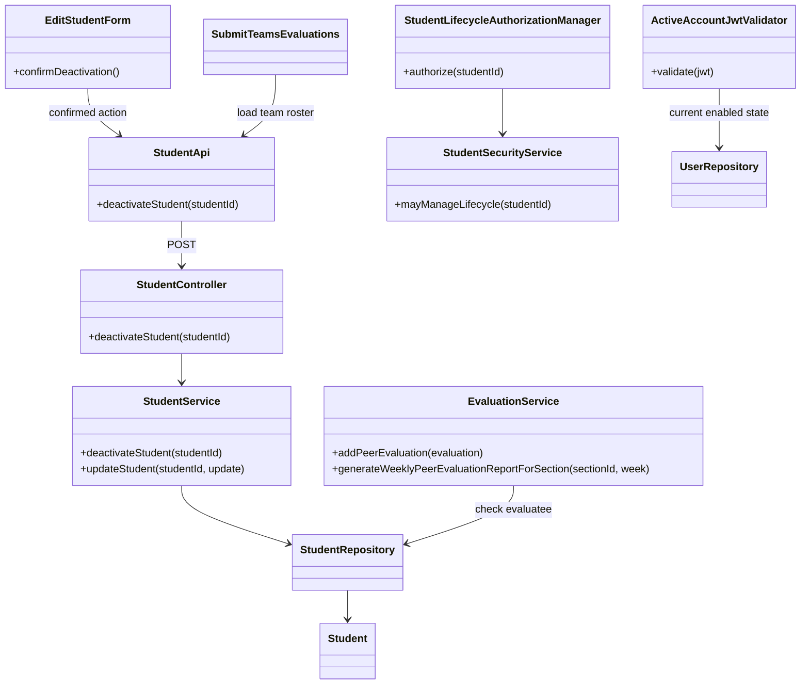
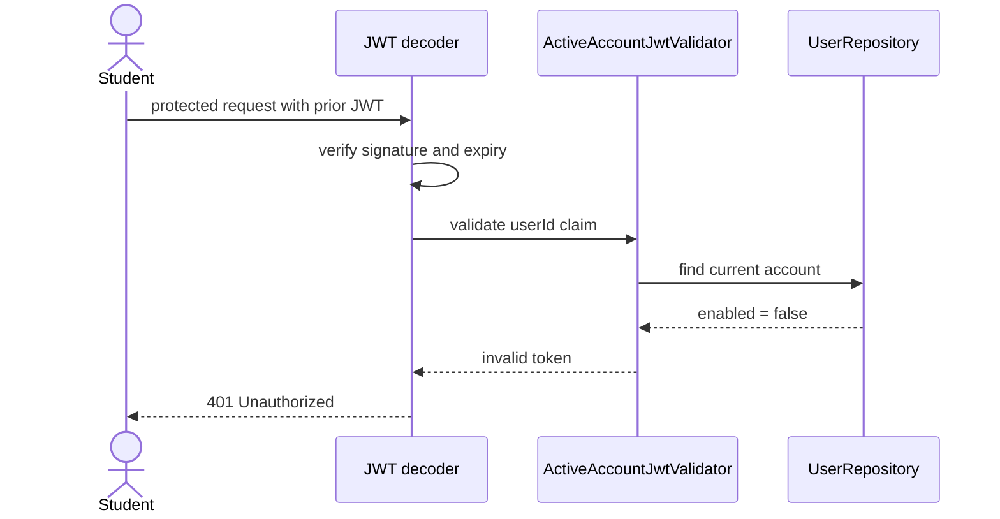

# Student Lifecycle Design

> Realizes: [UC-STU-deactivate-student](../requirements/use-cases.md#uc-stu-deactivate-student)
> Depends on: [FR-SEC-active-account](../requirements/software-requirements-specification.md#fr-sec-active-account), [FR-SEC-authorization](../requirements/software-requirements-specification.md#fr-sec-authorization), [BR-student-lifecycle](../requirements/business-rules.md#access-and-ownership), [BR-submission-owed](../requirements/business-rules.md#weekly-activity-report-and-peer-evaluation), [BR-peer-evaluation-active-evaluatee](../requirements/business-rules.md#weekly-activity-report-and-peer-evaluation), [BR-evaluation-editable-until-close](../requirements/business-rules.md#weekly-activity-report-and-peer-evaluation)
> See: [architectural design](architectural-design.md) (Container, authentication, authorization); [use cases](../requirements/use-cases.md); [SRS](../requirements/software-requirements-specification.md)

## Overview

Student account deactivation reuses the course participant model and adds a dedicated, confirmed action. It keeps the student and her team assignment and work records. The shared security layer checks the persisted account state on each bearer request, so an already-issued JWT stops authorizing protected requests after deactivation. The implementation stays within the existing Project Pulse API and SPA architecture.

## Components & classes



Reused components and their current files: [`EditStudentForm.vue`](../../frontend/src/pages/students/EditStudentForm.vue), [`Students.vue`](../../frontend/src/pages/students/Students.vue), [`student API`](../../frontend/src/apis/student/index.ts), [`StudentController`](../../backend/src/main/java/team/projectpulse/student/StudentController.java), [`StudentService`](../../backend/src/main/java/team/projectpulse/student/StudentService.java), [`StudentRepository`](../../backend/src/main/java/team/projectpulse/student/StudentRepository.java), [`StudentSecurityService`](../../backend/src/main/java/team/projectpulse/student/StudentSecurityService.java), [`SecurityConfiguration`](../../backend/src/main/java/team/projectpulse/security/SecurityConfiguration.java), [`UserRepository`](../../backend/src/main/java/team/projectpulse/user/UserRepository.java), [`UserService`](../../backend/src/main/java/team/projectpulse/user/UserService.java), [`MyUserPrincipal`](../../backend/src/main/java/team/projectpulse/user/MyUserPrincipal.java), [`EvaluationService`](../../backend/src/main/java/team/projectpulse/evaluation/EvaluationService.java), [`SubmissionStatusService`](../../backend/src/main/java/team/projectpulse/notification/SubmissionStatusService.java), and [`SubmitTeamsEvaluations.vue`](../../frontend/src/pages/evaluations/SubmitTeamsEvaluations.vue). New components and planned files: `StudentLifecycleAuthorizationManager` (`backend/src/main/java/team/projectpulse/security/authorizationmanagers/StudentLifecycleAuthorizationManager.java`) and `ActiveAccountJwtValidator` (`backend/src/main/java/team/projectpulse/security/ActiveAccountJwtValidator.java`).

## Sequence

### Deactivate a student (UC step 6)

```mermaid
sequenceDiagram
    actor Instructor
    participant Form as EditStudentForm
    participant API as student API
    participant Security as SecurityConfiguration
    participant Auth as StudentLifecycleAuthorizationManager
    participant Controller as StudentController
    participant Service as StudentService
    participant Repo as StudentRepository

    Instructor->>Form: choose Deactivate
    Form-->>Instructor: show consequence warning
    Instructor->>Form: confirm
    Form->>API: deactivateStudent(studentId)
    API->>Security: POST /students/{studentId}/deactivate
    Security->>Auth: check course owner or assigned instructor
    Auth-->>Security: allow
    Security->>Controller: continue request
    Controller->>Service: deactivateStudent(studentId)
    Service->>Repo: load student; set enabled false; save
    Repo-->>Service: student (team and work associations retained)
    Service-->>Controller: deactivated student
    Controller-->>API: Result(StudentDto)
    API-->>Form: success
    Form-->>Instructor: show confirmation; close dialog
```

### Repeated, unauthorized, and cancelled attempts (UC extensions 3a, 3b, 4a)

```mermaid
sequenceDiagram
    actor Instructor
    participant Form as EditStudentForm
    participant API as student API
    participant Security as SecurityConfiguration
    participant Auth as StudentLifecycleAuthorizationManager
    participant Service as StudentService

    alt instructor cancels warning (4a)
        Instructor->>Form: cancel
        Note over Form,API: No request is sent; account is unchanged
    else instructor confirms repeated request (3a)
        Instructor->>Form: confirm
        Form->>API: POST /students/{studentId}/deactivate
        API->>Security: request
        Security->>Auth: authorize
        Auth-->>Security: allow
        Security->>Service: deactivateStudent(studentId)
        Note over Service: Already disabled; no state change
        Service-->>API: success, already deactivated
    else caller is not authorized (3b)
        Instructor->>Form: confirm
        Form->>API: POST /students/{studentId}/deactivate
        API->>Security: request
        Security->>Auth: authorize
        Auth-->>Security: deny
        Security-->>API: 403 Forbidden
        API-->>Form: show access error
    end
```

### Reject a deactivated account's existing JWT (FR-SEC-active-account)



## API contract

| Endpoint | Caller | Request | Success | Errors, by extension |
|---|---|---|---|---|
| `POST /api/v1/students/{studentId}/deactivate` | Course admin who owns the student's course, or instructor assigned to the student's section | No body; `studentId` path parameter | `200` standard `Result` with `StudentDto`; an already-disabled student returns success with no state change | Unauthenticated: `401`. 3a: `200` idempotent success; 3b: `403` and account unchanged. A missing student is denied by the fail-closed lifecycle authorization check. 4a: no request is sent. |

The current base URL is configured by `api.endpoint.base-url`; the SPA uses the shared Axios client and unwraps the standard `Result` envelope.

## Key decisions

- Use a dedicated deactivation endpoint and action instead of the generic student update path. The generic enabled switch can bypass the warning; the old update service must not accept `enabled=false`. In the edit form, active accounts show the new Deactivate action; disabled accounts retain the existing reactivation control. No reactivation endpoint or behavior is added here.
- Register `POST /students/{studentId}/deactivate` with `.access(studentLifecycleAuthorizationManager)` in `SecurityConfiguration`. Authorize a course owner or the student's assigned instructor in a lifecycle-specific manager. The existing user-ownership manager also admits the student herself, while the student-instructor manager alone omits an unassigned course owner; neither matches `BR-student-lifecycle` by itself.
- Check the account's persisted enabled state while validating each bearer JWT. Letting an existing token expire after two hours conflicts with the selected immediate-revocation behavior. The per-request user lookup adds a database read; a generic token blocklist is rejected because it adds state and still needs an account-deactivation integration point.
- Keep inactive students in the team roster and section report query. Filtering them out would erase historical report visibility and alter team ownership; only new evaluatee selection and authoring exclude inactive accounts, per `BR-peer-evaluation-active-evaluatee` and `BR-submission-owed`.
- Enforce active evaluatee eligibility for new peer-evaluation records in both `SubmitTeamsEvaluations.vue` and `EvaluationService.addPeerEvaluation`. The UI avoids asking for an evaluation that cannot be saved; the service remains authoritative for crafted requests. An evaluation already saved before deactivation remains editable until its window closes (BR-evaluation-editable-until-close), and existing records remain visible in section reports.

## Data model

No data-model delta. Deactivation changes the existing `Student.enabled` value; team assignment, weekly activity reports, and peer-evaluation records remain attached as defined by the SRS Business Domain Model.

## Reuse & cross-cutting

The existing security filter chain, shared `UserRepository`, `StudentSecurityService`, `UserService` and `MyUserPrincipal.isEnabled()` login check, `Result` envelope, Axios client, team roster query, `SubmissionStatusService`, and peer-evaluation report path are reused. Password login already rejects disabled accounts through the existing `isEnabled()` contract. The new JWT validator addresses the separate case of an already-issued token. The filter-chain check applies to all protected API requests, including weekly-activity and peer-evaluation submissions; public login/registration routes and the non-sensitive SPA shell remain outside that protected-resource rule. The Level 1 authentication description will be clarified to distinguish immediate account disablement from generic JWT revocation; no component boundary changes.

## Tests

| Flow | Level | Assertion |
|---|---|---|
| UC-STU main success | Integration + UI | An assigned instructor and owning course admin deactivate an active student; the response reports disabled, while her team, weekly activity reports, and past evaluations remain. The confirmation warning precedes the request. |
| UC-STU extension 3a | Service + integration | Repeating deactivation succeeds without changing membership or records. |
| UC-STU extension 3b | Authorization integration | An unassigned instructor and a student are denied with 403; the target remains active. |
| UC-STU extension 4a | UI | Cancelling the warning sends no request and leaves the account active. |
| FR-SEC-active-account | Security integration | Disabled credentials cannot log in; a bearer token issued before deactivation receives 401 on its next protected request, including a submission request; an active account's token remains accepted. |
| BR-peer-evaluation-active-evaluatee | Service + integration | A new evaluation for an inactive evaluatee is rejected; one for an active evaluatee succeeds. Existing evaluation rows remain readable. |
| UC-EVA submit flow after deactivation | UI + service | A new evaluation form omits inactive teammates and the backend rejects crafted new records for them; previously saved evaluation rows remain editable during the allowed window. |
| Section evaluation report history | Service + integration | The deactivated student's prior evaluations remain present in the report for their evaluated weeks. |
| BR-submission-owed | Notification integration | A deactivated student is not listed as owing submissions, and active teammates are not required to evaluate her. |
| Generic student update guard | Service + integration | `PUT /students/{id}` cannot set an active student's enabled flag to false, so it cannot bypass the confirmation flow. |
